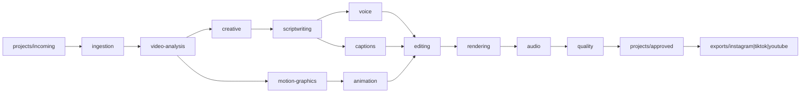

# Architecture

Shorts Studio produces one vertical master from a real app recording, then exports that master for Instagram, TikTok, and YouTube. People (later, Claude Code sessions following the specs in `/agents`) do the judgment. The code in `/engine` is the contract those sessions implement, plus a sample path that already runs.

## What is code, and what is a spec

| Path | Kind | Role |
| --- | --- | --- |
| `engine/` | TypeScript modules | Validate inputs, write stage artifacts, render the sample |
| `agents/` | Markdown role specs | How a Claude Code session should behave in that seat |
| `templates/` | Markdown production formats | How a chosen concept becomes a short |
| `projects/` | Working files | One folder per job, moving incoming → production → approved |
| `exports/` | Deliverables | Platform copies of an approved master. Gitignored media |
| `docs/` | System docs | Design, pipeline, setup, fill-in templates |

The sample orchestrator is `engine/produce.ts`. A future job should get its own entry that reuses the same stage functions, not a second copy of the render stack.

## Stage contracts

Each engine folder README states inputs and outputs. The sample writes those outputs under `projects/production/sample/`:

| Stage | Sample artifact | Sample behavior |
| --- | --- | --- |
| ingestion | `ingest.json` | Validates the placeholder manifest |
| video-analysis | `analysis.json` | Skips. No recording is attached |
| creative | `concept.json` | Blocks. No concepts without demonstrated features |
| scriptwriting | `script.md` | Quotes only the manifest's on-screen text |
| voice | `voice.json` | Plans a silent AAC bed. No provider is called |
| captions | `captions.srt`, `captions.json` | SRT from the same cues that are burned in |
| motion-graphics | `motion.json` | Title-card window and safe-area padding |
| animation | `animation.json` | No scene. The sample does not invent UI |
| editing | `edit.json` | Frame-accurate edit decision list |
| rendering | `media/picture.mp4`, `render.json` | Remotion composition `SampleShort` |
| audio | `media/master.mp4`, `audio.json` | ffmpeg copies video and muxes silent AAC |
| quality | `qa.json` | ffprobe must match the master spec |
| export | `exports/<platform>/sample-pipeline.*` | Same master, SRT, and a sidecar per platform |

`projects/approved/` is the human gate. The sample does not write there. A real job moves into `approved/` only after the quality controller and a person accept it.

## Master spec

The constants in `engine/format.ts` are the master. Every export in this foundation uses them. Platform differences are safe-area notes in the sidecar, not a second encode.

- Frame: 1080×1920, 9:16
- 30 fps
- MP4, H.264, yuv420p
- AAC, 48 kHz, stereo
- Captions burned into the picture, plus an optional SRT

## Render stack

The picture is a React composition rendered by [Remotion](https://www.remotion.dev/). Audio is muxed with ffmpeg, because the audible track is a separate decision from the picture (voice, music, and silence). The quality gate shells out to ffprobe.

That split follows the working approach of [claude-animated-shorts](https://github.com/mromidev/claude-animated-shorts): Remotion for the frame-accurate picture, ffmpeg for the sound mix, a probe-based check before anyone calls the file finished. The implementation here is original. See [NOTICE](../NOTICE). Animated scenes, if a later template needs them, belong in `engine/animation` and `engine/rendering` as new compositions. They are not a port of that project's bridge short.

## Data that must not be invented

`engine/schema.ts` rejects the sample manifest if it names an app, attaches a fake recording, or carries a call to action. Later jobs may name an app, but a claim still needs a citation in the analysis document: recording file, timecode, and what is visible. Agent specs and templates repeat this rule because the renderer will otherwise put false copy on screen.

Known identity, and nothing beyond it until a recording says otherwise:

- Product: LIVI
- URL: https://livi.aifans.ai
- Platform: iOS
- Description given with this repo: a language-learning app where you text native AI characters in Spanish, French, Japanese, and Korean

## Storage

Git holds the system, the sample JSON manifest, and docs. It does not hold screen recordings or rendered masters. `.gitignore` excludes `.env`, `node_modules`, video and audio binaries, `projects/production/*`, `projects/approved/*`, and the files written into `exports/`.

Keep source recordings and renders in Git LFS or, preferably, object storage (`ASSET_BUCKET_URL` in `.env.example`). A Claude Code cloud session should receive a link or a mounted path, not a commit full of `.mov` files.

## Credentials

API keys for a future voice provider live in `.env`, which is gitignored. `.env.example` has empty placeholders. The sample pipeline does not load `.env`.
